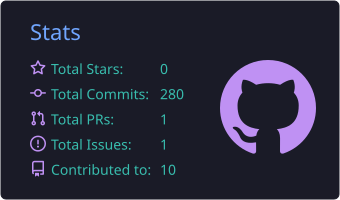
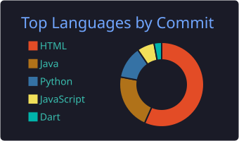

<div align="center">


</div>

<div align="center">

### Olá, seja bem-vindo(a) ao meu GitHub! 👋

**Teresina, PI — Brasil** 🇧🇷

[](https://www.linkedin.com/in/thiago-araújo-2005ab369/)
[](https://portifolio-thiagoaraujo.vercel.app/)
[](mailto:thiagoeajds@gmail.com)
[](https://wa.me/5586995214866)
</div>

---

##  • Sobre Mim

```javascript
const thiago = {
  nome:       "Thiago Emanuel Araújo Jorge de Sá",
  localidade: "Teresina, PI — Brasil",
  foco:       ["Desenvolvimento Web", "Full Stack", "Interfaces Modernas"],
  estudando:  ["Supabase", "Oracle"],
  pronomes:   "ele/dele",
};
```

---

## • Tecnologias & Ferramentas

**Frontend**


**Backend**


**Database**


**Qualidade & Testes**


**Ferramentas & Cloud**


---

## • Estatísticas

<div align="center">
  
  
</div>

---

<div align="center">


</div>
